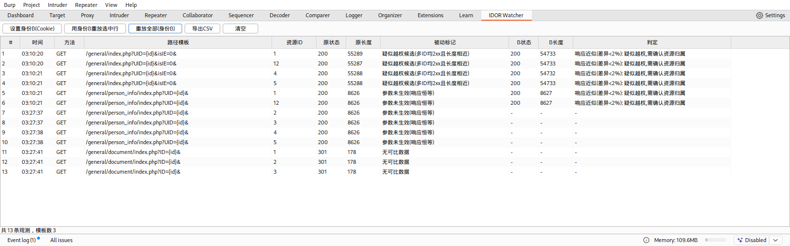

# Burp IDOR Watcher

一个 Burp Suite 的**被动式越权（IDOR）观察与验证插件**：在测试者正常浏览时自动归集同类请求，把"同路径不同资源 ID"的请求压缩成一份可疑清单，并支持换身份重放给出对照证据。



上图为实际运行界面：同一路径模板下聚合了多个资源 ID，`被动标记` 与重放后的 `判定` 分列展示，底部状态栏显示当前观测条数与模板数。


---

## 为什么写这个

越权（IDOR / 未授权访问）这类漏洞有个尴尬的特点：**扫描器基本打不出来**。

原因很直白——判定越权需要"另一个身份做对照"，而自动化扫描器全程只有一个会话。它看到 `GET /api/order/1001 → 200`，无法判断这个订单是不是"本来就该你能看"。

于是这类问题长期依赖人工：在 Burp 的 HTTP history 里翻几千条请求，逐条对比。这个过程**又慢又容易漏**。

这个插件想解决的就是中间那一步：**把几千条流量自动压成几十条候选**，把人工判断留给真正需要判断的地方。

---

## 一个必须先讲清楚的前提

> **"同一路径不同 ID 都返回 200" ≠ 越权。**

这句话是本插件所有设计取舍的出发点。下面三种完全不同的情况，在被动视角下长得一模一样：

| 真实情况 | 被动观察看到的现象 |
|---|---|
| 参数被忽略，接口返回公共页面 | 多 ID 均 2xx，长度相同 |
| **真越权**：身份 A 拿到了别的用户的资源 | 多 ID 均 2xx，长度相近 |
| **正常**：A 各自看到自己的资源 | 多 ID 均 2xx，长度可能相近 |

**只有换一个身份重放、对比响应内容，才能把三者区分开。**

所以本插件分两层：

- **被动层**：只读流量，做归一化 + 聚合 + 标记 → 产出**候选清单**（降噪，不下结论）
- **验证层**：手动触发的双身份重放 → 产出**对照证据**（仍不下结论，标注"疑似，需人工确认资源归属"）

插件刻意**不自动发包**。理由：自动重放会在你不知情的情况下向目标发送大量请求，这在真实项目里是不可接受的副作用。

---

## 工作原理

```
                        ┌─────────────────────────────────────────┐
   Proxy 流量 ─────────▶ │  ProxyResponseHandler.handleResponse()  │
                        │  （只读，返回 continueWith 原样放行）      │
                        └───────────────────┬─────────────────────┘
                                            │
                              ┌─────────────▼─────────────┐
                              │   路径 / 参数 模板归一化    │
                              │  /api/user/1001           │
                              │  /api/user/1002           │
                              │        ↓                  │
                              │    /api/user/{id}         │
                              └─────────────┬─────────────┘
                                            │
                              ┌─────────────▼─────────────┐
                              │  按模板聚合多个资源 ID      │
                              │  记录 状态码/长度/hash     │
                              └─────────────┬─────────────┘
                                            │
                    ┌───────────────────────┴───────────────────────┐
                    │                                               │
        ┌───────────▼────────────┐                   ┌──────────────▼───────────┐
        │  被动标记（不下结论）    │                   │  手动触发：双身份重放      │
        │  · 疑似越权候选          │                   │  替换 Cookie → sendRequest │
        │  · 参数未生效（响应恒等） │                   │  → 与原始响应对照          │
        │  · 存在权限边界          │                   │  · 响应完全一致            │
        └───────────┬────────────┘                   │  · 响应近似（<2%）         │
                    │                                │  · 两侧响应不同            │
                    │                                │  · 被拒绝（401/403/302）   │
                    └───────────────┬────────────────┴──────────────────────────┘
                                    │
                        ┌───────────▼───────────┐
                        │  UI 表格 + CSV 导出    │
                        │  （自动落盘一份）       │
                        └───────────────────────┘
```

---

## 功能

- **被动观察，零侵入**：挂载 `ProxyResponseHandler`，返回 `continueWith()` 原样放行，不修改任何请求或响应。
- **模板归一化**：路径数字段（`/user/1001`）、十六进制段、UUID 段统一替换为 `{id}`；查询参数按 `id / uid / user_id / deptId / orderId…` 等键名识别并归一。
- **按模板聚合**：同一模板下收集不同资源 ID，记录每个 ID 的状态码、响应长度、响应体哈希。
- **三重判据标记**：状态码 + 响应长度 + 响应体 hash，不是只看"是否 200"。
- **双身份重放**：替换 `Cookie` 后经 Burp 内部接口重发，与原始响应逐项对照。
- **CSV 导出 + 自动落盘**：手动导出到任意路径，同时每次更新自动写一份到临时目录，便于脚本消费。
- **身份 B 可预加载**：从 `java.io.tmpdir/idor-b-cookie.txt` 读取，省去反复粘贴。

---

## 判定规则

### 被动标记

| 条件 | 标记 | 含义 |
|---|---|---|
| 同模板仅 1 个 ID | `单点观测` | 无可比数据 |
| 同时存在 2xx 与 401/403/302 | `存在权限边界(有拒绝)` | 说明服务端有鉴权，是**反向信号** |
| 多 ID 均 2xx 且响应体 hash 全相同 | `参数未生效(响应恒等)` | 该参数被忽略，**不是越权** |
| 多 ID 均 2xx 且长度比 ≤ 1.3 | `疑似越权候选(多ID均2xx且长度相近)` | 值得人工看 |
| 多 ID 均 2xx 但长度差异大 | `多ID均2xx(长度差异大)` | 可能是各自数据 |

### 重放判定

| 条件 | 判定 |
|---|---|
| 身份 B 返回 401 / 403 / 302 | `无越权: 身份B被拒绝` |
| A、B 响应体 hash 完全相同 | `响应完全一致(参数未生效或公共资源，非越权)` |
| A、B 长度差 < 2% | `响应近似(差异<2%): 疑似越权,需确认资源归属` |
| 其他 | `两侧响应不同(差异 x%): 需人工判断是否同一资源` |

---

## 快速开始

### 1. 准备 Montoya API

插件编译需要 `montoya-api.jar`。它随 Burp 一起发布，但**不在 Maven Central 的最新版里**（截至撰写，Maven 上只有 2022 年的 `0.9.25`，与 2025.x 不兼容，会 `NoSuchMethodError`）。

正确做法是从你自己安装的 Burp 里抽出来：

```bash
# Linux / macOS
./scripts/extract-montoya-api.sh /path/to/burpsuite.jar ./lib

# Windows PowerShell
.\scripts\extract-montoya-api.ps1 -BurpJar "C:\Program Files\BurpSuite\burpsuite.jar" -OutDir .\lib
```

脚本会把 `burpsuite.jar` 内部的 `resources/Tooling/libraries/montoya-api.jar` 解出来。

> 为什么不用 Maven 依赖：API 与 Burp 版本强绑定。用旧版 API 编译出的插件，在新版 Burp 上加载会因方法签名变化直接抛错。

### 2. 编译

```bash
# Linux / macOS
./build.sh

# Windows
.\build.ps1
```

产物：`dist/idor-watcher.jar`（约 14 KB，无第三方依赖）。

也可以手动：

```bash
javac --release 17 -encoding UTF-8 -cp lib/montoya-api.jar -d out src/IdorWatcher.java
jar cf dist/idor-watcher.jar -C out .
```

### 3. 加载到 Burp

1. `Extensions` → `Installed` → `Add`
2. Extension type 选 **Java**
3. 选择 `dist/idor-watcher.jar`
4. 加载成功后多出一个 **`IDOR Watcher`** 标签页

---

## 使用

### 基本流程

1. **用身份 A 正常浏览**目标，让流量经过 Burp Proxy。插件会在后台自动归集，表格逐步出现条目。
2. 观察 `被动标记` 列，先排除 `参数未生效` 和 `存在权限边界` 这两类。
3. 点 **`设置身份B(Cookie)`**，粘贴身份 B 的 Cookie 头内容（不含 `Cookie:` 前缀）。
   - 或者把 Cookie 写进 `%TEMP%/idor-b-cookie.txt`，插件启动时自动加载。
4. 选中一行点 **`用身份B重放选中行`**，或点 **`重放全部(身份B)`** 批量处理。
5. 看 `判定` 列，把 `疑似越权,需确认资源归属` 的条目拉出来人工确认。
6. **`导出CSV`** 导出报告素材。

### 关于"身份 B"

插件**不生成**身份 B——它必须是你自己合法持有的第二个账号。

真实项目里的标准做法：向甲方申请两个不同权限的测试账号（一个高权限、一个普通用户），分别登录抓下两套 Cookie。只给一个账号的情况下无法测越权，这是项目启动时就该争取的资源。

> 注意区分两件事：**用漏洞伪造身份**是认证绕过；**用两个正常账号对比**才是越权测试。报告里必须分开写。

### 输出示例

`samples/sample-output.csv`（已脱敏）：

```csv
seq,time,method,template,resource_id,status,length,content_type,flag,identityB_status,identityB_length,verdict
1,"03:10:20","GET","/general/index.php?UID={id}&isIE=0&","1",200,55289,"text/html; charset=gbk","疑似越权候选(多ID均2xx且长度相近)","200","54733","响应近似(差异<2%): 疑似越权,需确认资源归属"
2,"03:10:20","GET","/general/index.php?UID={id}&isIE=0&","12",200,55287,"text/html; charset=gbk","疑似越权候选(多ID均2xx且长度相近)","200","54733","响应近似(差异<2%): 疑似越权,需确认资源归属"
```

---

## 已知局限

写在前面的，比藏在后面的可信。

| 局限 | 说明 | 可能的改进 |
|---|---|---|
| **动态内容导致比对失真** | 页面含时间戳 / 随机 token 时，响应体 hash 每次都不同，`响应完全一致` 这条规则永远命中不了，只能退化成"长度近似" | 响应体归一化（剥离时间戳、随机串、CSRF token）后再算 hash |
| **长度近似仍可能误报** | 两个不同页面长度恰好相差 2% 以内时会误标 | 结构化比对（JSON 按 key 比较）+ 相似度算法 |
| **重放需手动触发** | 不做自动扫描，避免向目标发送未预期请求 | 可按 scope 限制做半自动 |
| **不支持多身份** | 目前只保留一个身份 B | 支持 B / C / D 批量对照 |
| **仅覆盖 HTTP** | 不处理 WebSocket 流量 | 接入 `ProxyMessageHandler` |
| **同名参数识别有限** | 参数键名靠内置正则（`id / uid / user_id / orderId…`），自定义命名可能漏 | 支持自定义键名规则 |

另外，本插件**不做**以下事情（有意为之）：不自动判定"这是越权"、不生成 PoC、不绕过任何认证。

---

## 目录结构

```
burp-idor-watcher/
├── src/
│   └── IdorWatcher.java          # 单文件插件实现（约 480 行）
├── scripts/
│   ├── extract-montoya-api.sh    # 从 burpsuite.jar 抽取 API（Linux/macOS）
│   └── extract-montoya-api.ps1   # 同上（Windows）
├── samples/
│   └── sample-output.csv         # 输出样例（已脱敏）
├── docs/
│   └── PUBLISH.md                # 发布到 GitHub 的步骤说明
├── build.sh
├── build.ps1
├── CHANGELOG.md
├── LICENSE
└── README.md
```

---

## Roadmap

- [ ] 响应体归一化（剥离时间戳 / 随机值 / token）后再比对
- [ ] JSON 响应结构化比对（只比关键字段）
- [ ] 多身份（B/C/D）批量对照
- [ ] 右键菜单"用身份B重放本条"（`ContextMenuItemsProvider`）
- [ ] 结果按风险分排序，而非观测顺序
- [ ] 自定义资源 ID 键名规则

---

## 开发笔记

几个踩过的坑，记下来省得别人再踩：

1. **Montoya API 的版本必须在编译期与目标 Burp 对齐**
   Maven Central 上的 `net.portswigger.burp.extender:montoya-api` 最新只到 2022 年的 `0.9.25`。用它编译出的插件在 2025.x 上加载会抛 `NoSuchMethodError`。解法是从 `burpsuite.jar` 内部抽取同版本 API（见 `scripts/`）。

2. **确认接口签名不要靠记忆**
   `javap -classpath montoya-api.jar burp.api.montoya.proxy.http.ProxyResponseHandler` 能直接看到方法签名。比翻文档快，也不会猜错。

3. **OOXML 与 Java 的坑在这里不存在，但 Burp 的 UI 线程存在**
   `handleResponseReceived()` 在 Burp 的工作线程里执行，更新 Swing 表格必须 `SwingUtilities.invokeLater()`，否则偶发界面卡死。

4. **`headers()` 里拿不到 Cookie 时，用 `withHeader("Cookie", ...)` 覆写**
   重放时如果只 `addHeader`，会出现两个 Cookie 头，服务端行为不确定。

---

## License

[MIT](LICENSE)

## 免责声明

本工具仅供**授权的安全测试**使用。使用者需自行确保对目标系统拥有合法测试授权。作者不对任何未经授权使用造成的后果负责。
